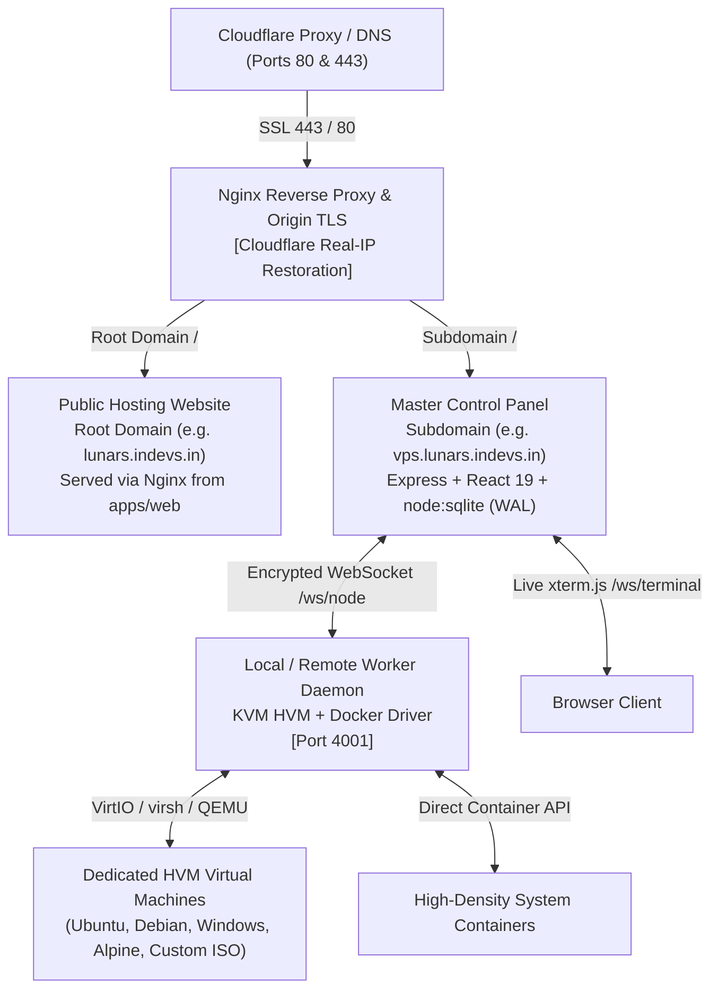
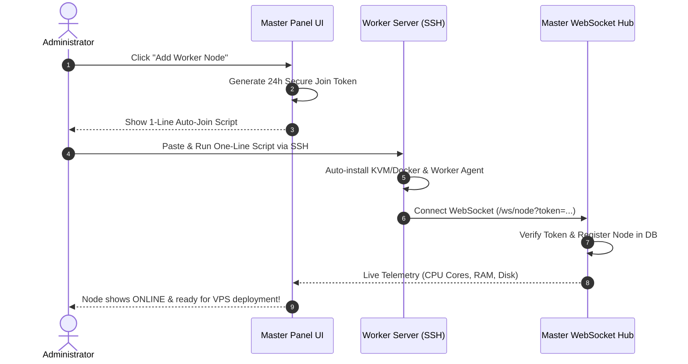

# Lunar VPS Panel - Dedicated HVM Cloud & Hypervisor Control Panel

A next-generation, high-performance **HVM (Hardware Virtual Machine)** and multi-node cloud virtualization control panel with a centralized Master Controller, interactive out-of-band Web Serial Console (`xterm.js`), automated IPAM, 8 visual design themes, public hosting website system, and distributed worker node daemons supporting **KVM Hardware Virtualization & High-Density System Containers**.


---

## 🌟 Key Features

- 🚀 **Dedicated HVM (Hardware Virtual Machine)**: Full hardware virtualization via KVM & QEMU with dedicated guest OS kernels, VirtIO bus acceleration, QCOW2 storage, swap memory, and support for Docker inside VPS, WireGuard VPNs, Linux, and Windows Server VMs.
- 🪟 **Windows & Graphical Desktop Support**: Native support for **Windows Server 2022, Windows Server 2019, Windows 11 Pro**, as well as graphical desktop environments (Ubuntu Desktop GUI, Debian Desktop GUI) with out-of-the-box SATA storage and display drivers.
- 💿 **Custom ISO Boot & Manual OS Install**: Mount any direct HTTP/HTTPS bootable `.iso` image as an IDE CD-ROM drive (`<boot dev='cdrom'/>`) to install your own customized distributions or proprietary operating systems.
- 🖥️ **Dual-Mode Web Console (Serial xterm.js + Web VNC Display)**: Switch between high-speed serial terminal (`xterm.js`) and full graphical in-browser **Web VNC Display** with virtual mouse, keyboard injection, and essential Windows key combos (`Send Ctrl+Alt+Del`, `Win Key`, `Alt+Tab`).
- ⚡ **Dual-Engine Hybrid Hypervisor**: Support for both dedicated HVM virtual machines and ultra-fast, high-density system containers (LXC / Docker) on the same cluster.
- 🌐 **Public Hosting Website / Client Portal System**: Built-in modern public-facing hosting website (`apps/web`) ready to install on your root domain (e.g. `lunars.indevs.in`) with live cluster telemetry ping and deep-linked pricing plans linked directly to your Master Panel (`https://vps.lunars.indevs.in`).
- 🎨 **8 Unique Visual Design Themes**: More than just colors — choose from 8 distinct layout styles and aesthetics (Cockpit Glass HUD, Minimalist Flat SaaS, Datacenter NOC Pro, Retro Synthwave, Terminal Matrix, Nordic Frost, OLED Pure Black, and Valkyrie Crimson).
- 🔓 **100% Free & Unlimited Forever**: Zero license restrictions, zero license keys required, zero artificial limits on nodes or VPS instances.
- 🖥️ **Interactive Web Serial Console (`xterm.js`)**: Real-time terminal shell connected directly to the guest VM or container via encrypted low-latency WebSockets.
- 🛡️ **Cloudflare & Nginx Dual-Port SSL**: Automated Nginx reverse proxy with Cloudflare Real-IP restoration and Dual-Port support (HTTP 80 + HTTPS 443).
- 💻 **All-In-One Unified CLI (`vps-panel`)**: Full system management command utility (`install`, `install-web`, `update`, `status`, `start`, `stop`, `restart`, `logs`, `uninstall`).
- ⚡ **1-Click Web UI In-Panel Updater**: Check for updates and upgrade your cluster directly from the browser with automatic database backups.
- 🌐 **Automated IPAM (IP Address Management)**: Subnet pools, automatic gateway/netmask configuration, and IP assignment on VPS creation.
- 🖥️ **Unlimited Multi-Node Clustering**: Connect external bare-metal or cloud worker servers to your central dashboard via secure join tokens.

---

## 🏗️ Architecture Overview



---

## ⚡ Quick 1-Command Installation

Run this single command on your Linux VPS (supports **Ubuntu 20.04/22.04/24.04, Debian 11/12, CentOS/AlmaLinux/Rocky 8/9, Bare Metal, KVM, Docker, LXC, and WSL**):

```bash
bash <(curl -sSL https://raw.githubusercontent.com/prcgaming/vps-panel/main/install.sh)
```

### 🎯 Which Option to Choose When Running the Script?

When you run the command, the installer displays an interactive numbered menu:

```text
Select what you would like to do:

  [1] Install Complete VPS Panel (Recommended - Panel + Built-in Local HVM Node - Ready to create VPS!)
  [2] Install Public Hosting Website / Client Portal (Root domain e.g. lunars.indevs.in)
  [3] Connect External Worker Node (Only for 2nd/external servers - requires join token from panel)
  [4] Configure Cloudflare Domain & Nginx SSL for Panel
  [5] Check Status & Health
  [6] Update VPS Panel to Latest GitHub Release
  [7] Restart Services
  [8] View Realtime Logs
  [9] Uninstall Panel
  [0] Exit

Input 1-9 (or press Enter for [1]):
```

👉 **Choose Option `[1]`** (or simply press **Enter**, as `1` is the default)!

> 💡 **No Worker Node Token Needed:** The Master Panel includes its own built-in hypervisor node automatically. Join tokens are **only** needed if you are adding a secondary/external server later under **Nodes** in your dashboard.

#### Step-by-Step Questions Answered in Option `1`:

| Step / Prompt | What to Enter / Recommended Choice |
|---|---|
| **1. Domain Name** | Enter your panel subdomain (e.g. `vps.lunars.indevs.in`) or press Enter to use server IP. |
| **2. Public Website `[y/N]`** | Type **`y`** if you want to deploy the public hosting website on your root domain (e.g. `lunars.indevs.in`), or **`N`** for panel only. |
| **3. Brand Name** | Enter your hosting company or brand name (e.g. `Lunar Cloud HVM`). |
| **4. Hypervisor Engine** | Choose **`1`** for **Dedicated HVM (KVM / QEMU)** (Supports Windows, Linux, Desktop GUI & Custom ISO). |
| **5. Design Theme** | Choose your favorite starting theme preset (e.g. `1` for Cyber Cyan, `2` for Electric Indigo, `7` for OLED Black). |
| **6. Admin Account** | Enter your **Admin Email** and **Password** for dashboard login. |

The installer will then automatically install Node.js, KVM packages, build the panel, configure Nginx SSL, seed OS templates, and start all services!

---

### ⚡ Express 1-Click Install with Domain (Skips Menu)

If you already have your domain pointed to your server's IP and want to skip the menu entirely:

```bash
bash <(curl -sSL https://raw.githubusercontent.com/prcgaming/vps-panel/main/install.sh) vps.lunars.indevs.in
```

---

## 🌐 How to Install the Public Hosting Website on Root Domain

You can deploy the public-facing cloud hosting website on your root domain (e.g. `lunars.indevs.in`) and automatically link it to your Master Panel (`https://vps.lunars.indevs.in`):

### 1-Line CLI Command:
```bash
vps-panel install-web lunars.indevs.in https://vps.lunars.indevs.in
```

### Or via the Interactive Menu:
Run `vps-panel` and choose option **[2] Install Public Hosting Website / Client Portal**:
1. Enter your website domain (e.g. `lunars.indevs.in`).
2. Enter your linked Master Panel URL (e.g. `https://vps.lunars.indevs.in`).
3. Enter your brand name (e.g. `Lunar Cloud HVM`).
4. The installer configures Nginx, Origin SSL, Cloudflare Real-IP, and serves the portal with real-time cluster telemetry!

---

## 🎨 8 Visual Design Themes & Layout Styles

VPS Panel features 8 distinctly different visual design themes and layout styles that alter card radius, borders, background patterns, and telemetry:

| Theme Preset | Visual Design Style | Card Radius | Aesthetic Description |
|---|---|---|---|
| **Cyber Cyan** *(Default)* | **Glassmorphic Cyber-HUD** | `rounded-2xl` | Futuristic sci-fi cockpit with frosted glass panels, neon cyan glow & cybernetic grids |
| **Electric Indigo** | **Modern Flat SaaS** | `rounded-xl` | Linear & Stripe inspired minimalism with crisp slate surfaces and clean indigo focus |
| **Midnight Stealth** | **Enterprise Datacenter Pro** | `rounded-none` | NOC & server-rack industrial aesthetic with sharp squared corners and dense telemetry |
| **Rose Sakura** | **Retro Synthwave Arcade** | `rounded-2xl` | 80s outrun aesthetic with hot pink glow, cyber magenta, and arcade retro styling |
| **Emerald Matrix** | **Hacker Terminal Matrix** | `rounded-xl` | Cybersecurity terminal console with phosphor green glow, dark scanlines & monospace badges |
| **Nordic Frost** | **Nordic Frost Glass** | `rounded-3xl` | Scandinavian calm luxury with ice blue tones, ultra-smooth rounded-3xl cards, and arctic glass |
| **Midnight OLED** | **True Black OLED Monolith** | `rounded-xl` | 100% pure `#000000` pitch black background for zero glare, battery saving, and razor-sharp contrast |
| **Crimson Blood** | **Combat Valkyrie Crimson** | `rounded-2xl` | High-performance gaming cockpit aesthetic with deep ruby crimson glow and fiery energy |

### How to Switch Themes:
- **Navbar Quick Picker**: Click the **Palette** icon in the top header to preview and switch themes in real time with 1 click.
- **Settings Page**: Go to **Settings & Themes** -> Click **Save as Cluster Default** to set the theme permanently for all users and the login screen.
- **During Installation**: The interactive setup wizard allows you to pick your initial theme right from the terminal prompt.

---

## 🚀 HVM (Hardware Virtual Machine), Windows & Custom ISO

When creating a VPS instance in the panel, choose **Dedicated HVM (KVM / QEMU)**:

- **🪟 Windows Server & Windows 11**: Dedicated virtual machines with SATA bus controllers and pre-configured VNC graphics. Open the Web VNC Console to complete installation and click **Send Ctrl+Alt+Del** to sign in.
- **🖥️ Graphical Desktop Distros**: Pre-configured Ubuntu Desktop GUI and Debian Desktop GUI templates with XFCE desktop environment accessible directly inside the browser.
- **💿 Custom ISO Boot**: Provide a direct HTTP/HTTPS URL to any bootable `.iso`. The agent attaches it as an IDE CD-ROM with `<boot dev='cdrom'/>` and `<boot dev='hd'/>` fallback.
- **Isolated Kernel**: Unlike containers, HVM VMs boot their own independent Linux or Windows kernel.
- **Full Docker & K8s Support**: Run nested Docker containers, Kubernetes, Podman, and LXC inside your VPS.
- **WireGuard & OpenVPN**: Full `/dev/net/tun` network interface support without host permission barriers.
- **VirtIO High-Speed Storage**: Backed by QCOW2 sparse virtual disks with copy-on-write snapshots and resizing.
- **Universal Compatibility**: Works with native hardware VT-x/AMD-V acceleration (`/dev/kvm`), with automatic QEMU TCG software emulation fallback for non-nested VPS environments.

---

## 💻 All-In-One Unified CLI Command (`vps-panel`)

The installer places a global binary into your system PATH (`/usr/local/bin/vps-panel` and `/usr/bin/vps-panel`). Manage everything with simple commands:

| Command | Action |
|---|---|
| `vps-panel install [domain]` | Install or reconfigure Master Panel with SSL |
| `vps-panel install-web [domain] [url]` | Install the public hosting website on root domain |
| `vps-panel update` | Update panel to the latest GitHub release |
| `vps-panel status` | Check live health and service status |
| `vps-panel start` | Start Master Panel backend, Nginx, and Worker Agent |
| `vps-panel stop` | Stop Master Panel backend and Worker Agent |
| `vps-panel restart` | Restart Master Panel, Worker Agent, and Nginx |
| `vps-panel logs` | Stream live real-time backend logs |
| `vps-panel uninstall` | Cleanly remove panel with automated database backup |

> **Interactive Menu:** Run `vps-panel` without arguments to open the numbered menu.

---

## ⚡ 1-Click In-Panel Update (Web UI)

You can update the VPS Panel directly from your web browser with zero terminal commands:
1. Log in to the Admin Dashboard and navigate to **Settings & Themes** in the sidebar.
2. Scroll to the **Panel Updates & Maintenance** section.
3. Click **Check for Updates** to verify sync status with GitHub `main`.
4. Click **⚡ 1-Click Update Now**:
   - The server preserves your SQLite database, configurations, and active VPS instances.
   - It downloads the latest pre-built release and reloads the services automatically in the background.
   - Your browser page will refresh in ~6 seconds with the latest update live!

---

## 🖥️ Complete Guide: How to Setup & Connect Worker Nodes

VPS Panel allows you to create an unlimited multi-server cluster. Worker nodes are external bare-metal or cloud servers that run hypervisors (KVM or Docker) and report hardware telemetry back to your Master Controller.



### 🚀 1-Click Automated Setup (Recommended)
1. **Log In to Master Panel**: Open your dashboard (e.g. `https://vps.lunars.indevs.in`) and click **Nodes & Hypervisors**.
2. **Generate Join Command**: Click **Connect New Node**, choose a name and driver (`kvm` or `docker`), and copy the command.
3. **Run on Worker VPS**: Run the copied command as `root` via SSH.
4. **Done**: The node connects and appears **ONLINE** in your panel within seconds!

---

## 🌐 Cloudflare DNS & SSL Configuration

### Step 1: Point Your Domain in Cloudflare
1. Open your **Cloudflare Dashboard** -> Select your Domain -> **DNS**.
2. Add records:
   - **Root Domain** (`@` or `lunars.indevs.in`): Points to VPS Public IP (for the Public Website)
   - **Subdomain** (`vps` or `vps.lunars.indevs.in`): Points to VPS Public IP (for the Master Panel)
   - **Proxy Status**: Proxied (Orange Cloud) — *fully supported with automated Real-IP restoration!*
3. Under **SSL/TLS**: Ensure Encryption Mode is set to **Full** or **Flexible**.

### Step 2: Run the Installer
```bash
# Install Panel
bash <(curl -sSL https://raw.githubusercontent.com/prcgaming/vps-panel/main/install.sh) vps.lunars.indevs.in

# Install Public Website
vps-panel install-web lunars.indevs.in https://vps.lunars.indevs.in
```

---

## 📋 Network Ports & Firewall

| Port | Protocol | Purpose |
|---|---|---|
| `80` | TCP | HTTP Web Traffic (Nginx Reverse Proxy) |
| `443` | TCP | HTTPS Encrypted Web Traffic & WebSocket Console |
| `4000` | TCP | Master Controller Internal API (Localhost / Reverse Proxy) |
| `4001` | TCP | Worker Node Daemon (Telemetry & Remote Orchestration) |
| `5900-5999` | TCP | Dedicated VNC Display Ports for Windows & GUI Guests |

---

## 📄 License
This project is open-source under the [MIT License](LICENSE). 100% Free, Unrestricted, and Unlimited.
