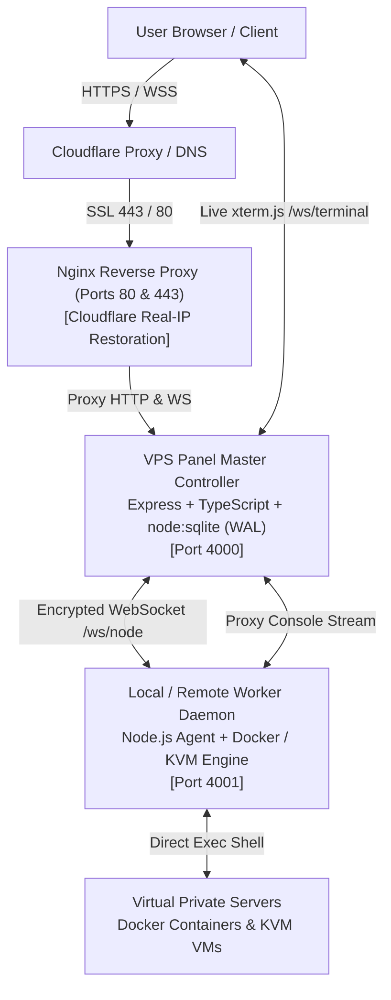

# VPS Panel - Multi-Node Cloud & Hypervisor Control Panel

A modern, high-performance, multi-node VPS (Virtual Private Server) control panel with a centralized Master Controller, interactive Web Console (`xterm.js`), IPAM, and distributed worker node daemons supporting **Hybrid Virtualization (Docker System Containers & KVM Hardware Virtualization)**.


---

## 🌟 Key Features

- ⚡ **1-Click Pterodactyl-Style Fast Installer**: Deploy your master panel and worker daemon in under 60 seconds with zero complicated manual dependencies.
- 🐳 **100% Real Infrastructure & Zero-Mock Guarantee**: Real official Docker Engine and KVM hypervisor integration. Real container creation, real hardware resource limits (vCPU, RAM, Disk), and real isolation.
- 🖥️ **Interactive Web Console (`xterm.js`)**: Real-time terminal shell connected directly to `/bin/bash` or `/bin/sh` inside your VPS instances via encrypted WebSockets.
- 🎨 **8 High-Tech Color Theme Presets**: Switch between 8 futuristic cyberpunk and modern enterprise themes in 1-click via the header quick picker or settings editor.
- 🌐 **Public Self-Service & Hosting Provider Mode**: Toggles for public user registration, user self-service VPS deployment, power management permissions, and per-user instance quotas.
- 🛡️ **Cloudflare & Nginx Dual-Port SSL**: Automated Nginx reverse proxy with Cloudflare Real-IP restoration and Dual-Port support (HTTP 80 + HTTPS 443).
- 💻 **Unified CLI Binary (`vps-panel`)**: Full command-line management utility (`update`, `status`, `start`, `stop`, `restart`, `logs`, `install`, `uninstall`).
- ⚡ **1-Click Web UI In-Panel Updater**: Check for updates and upgrade your cluster directly from the browser with database safety backups.
- 🌐 **Automated IPAM (IP Address Management)**: Subnet pools, automatic gateway/netmask configuration, and IP assignment on VPS creation.
- 🖥️ **Unlimited Multi-Node Clustering**: Connect external bare-metal or cloud worker servers to your central dashboard via secure join tokens.

---

## 🏗️ Architecture Overview



---

## ⚡ Quick 1-Command Installation

Run this single command on your Linux VPS (supports **Ubuntu 20.04/22.04/24.04, Debian 11/12, CentOS/AlmaLinux/Rocky 8/9, Bare Metal, KVM, Docker, LXC, and WSL**):

```bash
bash <(curl -sSL https://raw.githubusercontent.com/prcgaming/vps-panel/main/install.sh)
```

### ⚡ Express Install with Domain

If your domain (e.g. `panel.yourdomain.com`) is pointed to your VPS:

```bash
bash <(curl -sSL https://raw.githubusercontent.com/prcgaming/vps-panel/main/install.sh) panel.yourdomain.com
```

---

## 🛠️ Interactive Setup Wizard (100% Real Setup)

The installer will guide you through configuring real infrastructure step by step:

1. **Domain or Public IP**: Enter your domain (e.g. `vps.lunars.indevs.in`) or press enter to use your VPS public IP.
2. **Panel Brand Name**: Set your custom title (e.g. `Lunar VPS Panel`).
3. **Color Theme Preset**: Select your initial theme from 8 color presets (`Cyber Cyan`, `Purple Nebula`, `Emerald Matrix`, etc.).
4. **Super Admin Account**: Configure your admin email and password (or press enter to auto-generate a secure password).
5. **Virtualization Hypervisor**: Select Docker containers (high density & instant boot) or KVM (hardware VMs).
6. **Automatic Docker Engine Setup**: Installs the official Docker Engine, enables the service, and pre-pulls base images (`alpine:3.20`, `debian:12-slim`, `ubuntu:24.04`) so newly created VPS instances launch instantaneously.
7. **Local Hypervisor Node**: Detects the host's actual CPU cores and RAM and registers the VPS itself as an active hypervisor node.
8. **Service Supervision**: Configures Systemd services (or SysV init & PM2 in non-systemd container environments).
9. **Cloudflare Real-IP & Nginx SSL**: Configures reverse proxy with Dual-Port SSL on ports 80 and 443.
10. **Global CLI Utility**: Installs `/usr/local/bin/vps-panel` globally on your VPS.

---

## 🎨 8 High-Tech Color Theme Presets

VPS Panel includes 8 cyber and modern enterprise theme presets that dynamically customize the entire UI:

| Theme Preset | Color Scheme | Style Description |
|---|---|---|
| **Cyber Cyan** *(Default)* | Electric Cyan (`#06b6d4`) & Deep Blue (`#3b82f6`) | Lunar high-tech cyber aesthetic with electric cyan glow |
| **Purple Nebula** | Cosmic Violet (`#a855f7`) & Synthwave Magenta (`#ec4899`) | Deep space interstellar purple with vibrant neon blooms |
| **Emerald Matrix** | Hacker Green (`#10b981`) & Phosphor Teal (`#14b8a6`) | Cybersecurity terminal green inspired by classic mainframe consoles |
| **Crimson Blood** | Ruby Crimson (`#ef4444`) & Fiery Rose (`#f43f5e`) | High-contrast blood red with aggressive dark-mode accents |
| **Golden Amber** | Solar Flare Gold (`#f59e0b`) & Sunset Orange (`#ea580c`) | Warm molten solar gold and rich amber radiance |
| **Rose Sakura** | Synthwave Pink (`#f43f5e`) & Radiant Fuchsia (`#d946ef`) | Anime cyberpunk neon pink with electric violet highlights |
| **Electric Indigo** | Deep Space Indigo (`#6366f1`) & Royal Violet (`#8b5cf6`) | Ultra-clean modern enterprise indigo and royal purple |
| **Midnight Stealth** | Industrial Carbon (`#94a3b8`) & Monochrome Steel (`#64748b`) | Minimalist monochrome dark stealth with crisp steel contours |

### How to Switch Themes:
- **Navbar Quick Picker**: Click the **Palette** icon in the top header to preview and change themes in real time with 1 click.
- **Settings Page**: Go to **Settings & License** -> **Color Theme Presets** -> Click **Set as System Default Theme** to make your favorite theme the default for the entire cluster and login screen.
- **During Installation**: The interactive setup wizard lets you select your preferred color theme right from the terminal prompt.

---

## 💻 All-In-One Unified CLI Command (`vps-panel`)

The installer installs a global binary `vps-panel` into your VPS system PATH (`/usr/local/bin/vps-panel` and `/usr/bin/vps-panel`). You can perform any management action with a single command:

| Command | Action |
|---|---|
| `vps-panel update` | Update panel to the latest GitHub release |
| `vps-panel status` | Check live health and service status |
| `vps-panel start` | Start Master Panel backend, Nginx, and Worker Agent |
| `vps-panel stop` | Stop Master Panel backend and Worker Agent |
| `vps-panel restart` | Restart Master Panel, Worker Agent, and Nginx |
| `vps-panel logs` | Stream live real-time backend logs |
| `vps-panel install [domain]` | Install or reconfigure panel for a domain |
| `vps-panel uninstall` | Cleanly remove panel with automated database backup |

> **Interactive Menu:** Running `vps-panel` without arguments displays a numbered interactive menu.
>
> **Direct curl execution:** You can also run any subcommand via curl without installing:
> ```bash
> bash <(curl -sSL https://raw.githubusercontent.com/prcgaming/vps-panel/main/install.sh) update
> bash <(curl -sSL https://raw.githubusercontent.com/prcgaming/vps-panel/main/install.sh) status
> bash <(curl -sSL https://raw.githubusercontent.com/prcgaming/vps-panel/main/install.sh) restart
> ```

---

## ⚡ 1-Click In-Panel Update (Web UI)

You can update the VPS Panel directly from your web browser with zero terminal commands:
1. Log in to the Admin Dashboard and navigate to **Settings & License** in the sidebar.
2. Scroll to the **Panel Updates & Maintenance** section.
3. Click **Check for Updates** to see the current version and sync status with GitHub `main`.
4. Click **⚡ 1-Click Update Now**:
   - The server safely preserves your SQLite database, configurations, and active VPS instances.
   - It downloads the latest pre-built release and reloads the services automatically in the background.
   - Your browser page will refresh in ~6 seconds with the latest update live!

---

## 🌐 Public Use & Hosting Provider Mode

VPS Panel is designed for both private clusters and public hosting providers. You can easily enable or disable public access directly from the web interface without touching terminal files:

1. Log in to the Admin Dashboard and click **Settings & License** in the sidebar.
2. Toggle any of the following self-service options:
   - **Public User Registration**: Allow new visitors to click *Create Account* and sign up on the login page.
   - **Client VPS Deployment**: Allow registered users to create and launch their own VPS instances.
   - **Client Power Controls**: Allow users to Start, Stop, and Restart their own VPS instances.
   - **Max VPS Quota per User**: Configure how many instances each client user can deploy (e.g. 1, 2, 5).
3. Click **Save Panel Branding & Settings**.

---

## 🎨 Easy Branding & Customization

You can customize the panel's appearance right from the browser:
- **Panel Title**: Rename from default to your own brand (e.g. *Lunar VPS Panel*).
- **Company Name**: Set your hosting organization name.
- **Support / Discord URL**: Add your community support link.
- **Custom Logo URL**: Provide your company logo image or icon URL.
- **Default Hypervisor**: Choose Docker containers, KVM hardware virtualization, or Mock.

---

## 🖥️ Connecting External Worker Nodes

Scale your cluster by connecting unlimited external Linux servers:

1. Go to **Nodes** in your panel dashboard.
2. Click **Add Worker Node** and generate a Join Token.
3. On your remote worker server, run:
```bash
bash <(curl -sSL https://raw.githubusercontent.com/prcgaming/vps-panel/main/install.sh) --node
```
4. Enter your Master Panel URL and the Join Token. The node will automatically connect, stream live telemetry (CPU, RAM, Disk), and accept VPS creation commands!

---

## 🔑 Licensing Engine

VPS Panel includes a verifiable licensing engine:
- **30-Day Pro Tier**: Evaluation tier with unlimited multi-node clustering and unlimited VPS instances.
- **Lifetime Enterprise Tier**: Permanent, unrestricted tier with enterprise branding and priority badge.
- Pre-activated trial access is configured upon initial installation.
- Tiers can be activated or upgraded anytime in the panel under **Settings & License**.

---

## 🌐 Cloudflare DNS & SSL Configuration

### Step 1: Point Your Domain in Cloudflare
1. Open your **Cloudflare Dashboard** -> Select your Domain -> **DNS**.
2. Click **Add Record**:
   - **Type**: `A`
   - **Name**: `panel` (or `@` for root, e.g. `vps.yourdomain.com`)
   - **IPv4 Address**: Your VPS Public IP
   - **Proxy Status**: Proxied (Orange Cloud) or DNS Only (Grey Cloud) — *both are fully supported!*
3. Under **SSL/TLS**: Ensure Encryption Mode is set to **Full** or **Flexible**.

### Step 2: Run the Installer
```bash
bash <(curl -sSL https://raw.githubusercontent.com/prcgaming/vps-panel/main/install.sh) panel.yourdomain.com
```

The installer restores Cloudflare real client IP headers in Nginx and establishes origin TLS encryption on port 443 and HTTP on port 80.

---

## 📋 System Requirements & Network Ports

### Minimum Hardware:
- **CPU**: 1 Core (x86_64 or ARM64)
- **RAM**: 1 GB (Installer automatically provisions a 2GB swap file on low-memory VPS)
- **Disk**: 10 GB SSD / NVMe
- **OS**: Ubuntu 20.04+, Debian 11+, CentOS 8+, Rocky Linux 8+, AlmaLinux 8+

### Network Ports:
| Port | Protocol | Purpose |
|---|---|---|
| `80` | TCP | HTTP Web Traffic (Nginx Reverse Proxy) |
| `443` | TCP | HTTPS Encrypted Web Traffic & WebSocket Console |
| `4000` | TCP | Master Controller Internal API (Localhost / Reverse Proxy) |
| `4001` | TCP | Worker Node Daemon (Telemetry & Remote Orchestration) |

---

## 📄 License
This project is open-source under the [MIT License](LICENSE).
