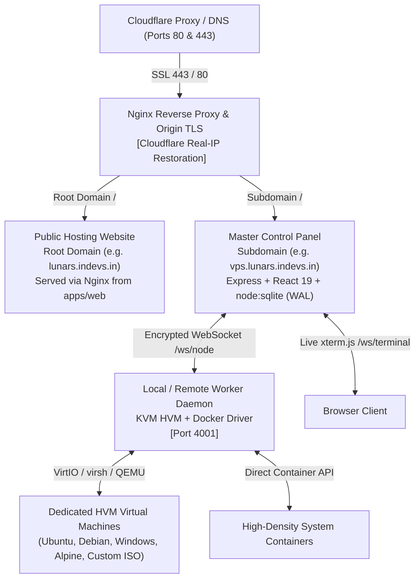

# ⚡ Lunar VPS Panel - Dedicated HVM Cloud & Hypervisor Control Platform

<div align="center">


<p align="center">
  A next-generation, luxury-grade <b>HVM (Hardware Virtual Machine)</b> and multi-node cloud virtualization orchestrator. Featuring a dedicated <b>Client Cloud Console (<code>/panel</code>)</b>, <b>Platform Administrator Console (<code>/admin-panel</code>)</b>, Pterodactyl-style server management (Live File Manager, 1-Click SSH Maker, Real-time xterm.js serial console, in-browser Web VNC, OS Rebuild), a full <b>WordPress-style visual page builder</b>, dynamic <b>Navigation & Menu Manager</b>, automated IPAM, 8 luxury design themes, custom wallpaper support, and distributed hypervisor clustering supporting <b>KVM Hardware Virtualization & High-Density System Containers</b>.
</p>

[**Quick Install**](#-quick-1-command-installation) • [**Key Features**](#-key-features) • [**WordPress Page Builder**](#-wordpress-style-page-builder--menu-manager) • [**CLI Commands**](#-all-in-one-unified-cli-command-vps-panel) • [**Multi-Node Setup**](#-multi-node-clustering--hypervisors) • [**Public Website**](#-public-hosting-website-deployment)

</div>

---

## 🌟 Key Features

### 🎮 Pterodactyl-Style Server Management
- 📁 **Real-Time Web File Manager**: Browse files with breadcrumbs, upload, edit in a dark-mode code editor with syntax highlighting, create files/folders, and delete with safety confirmations.
- 🔑 **1-Click SSH Key Maker**: Instant 2048-bit RSA key pair generation with automatic injection into `/root/.ssh/authorized_keys`, `.pem` private key download, and one-click SSH copy string (`ssh -i id_rsa.pem root@<ip> -p 22`).
- 🌐 **Collaborative Web Terminal (SSHX)**: Encrypted collaborative terminal sessions accessible directly over the web.
- 🔒 **Root Credential Vault**: View, copy, hide, and securely reset root passwords on the fly.
- 🔄 **1-Click OS Rebuild**: Reinstall Ubuntu, Debian, Alpine, Windows Server, Desktop GUI, or custom ISOs in seconds.

### 📝 WordPress-Style CMS & Navigation Menu Manager
- ✍️ **Rich Visual & Code Page Editor**: Built-in toolbar with H1/H2/H3 headings, bold, italic, underline, strikethrough, blockquotes, inline/block code, bullet/numbered lists, link/image prompts, tables, alert callout boxes, and CTA action cards.
- 👁️ **Live Website Preview**: Toggle between editor mode and real-time live preview styled identically to the public website's dark-mode theme.
- ⚡ **One-Click Pre-made Templates**: Instant templates for Terms of Service, Privacy Policy, Server Rules, About Us, and Feature Comparison Tables.
- 🧭 **Navigation & Menus Manager (`Appearance > Menus` style)**:
  - Add any custom page to the Header Navigation or Footer with 1 click.
  - Add custom external links (e.g. Discord, Documentation, Billing, Status page).
  - **Completely remove default links** (e.g. "Compute Plans", "Cluster Health", "FAQ", "Client Panel", "HVM Virtualization").
  - Re-order links with `[↑]` and `[↓]` buttons.
  - Inline editing of labels and URLs directly on menu cards.
- 👁️‍🗨️ **Section Visibility Controls**: Toggle or completely remove default premade homepage sections (Pricing Plans, Hero Banner, Features Grid, Cluster Telemetry, FAQ).

### 🔀 Clean Routing & Client/Admin Separation
- `/login`: Premium glassmorphic authentication and client registration portal.
- `/panel`: Default Client Cloud Console for managing virtual servers, viewing templates, and accessing console sessions.
- `/admin-panel`: Platform Administrator Console for worker nodes, IP networks, client accounts, and cluster settings. Administrators switch seamlessly between `/panel` and `/admin-panel` with a 1-click toggle near their profile.

### 🚀 Dedicated HVM (Hardware Virtual Machine)
- **True Hardware Virtualization**: Full KVM & QEMU virtual machines with independent guest OS kernels, VirtIO bus acceleration, QCOW2 virtual disks, swap memory, and nested virtualization support (Docker, WireGuard, VPNs, Kubernetes).
- 🪟 **Windows Server & Windows 11**: Dedicated virtual machines with SATA bus controllers and pre-configured VNC graphics.
- 🖥️ **Desktop GUI Distros**: Pre-configured Ubuntu Desktop GUI and Debian Desktop GUI templates with XFCE accessible in the browser.
- 💿 **Custom ISO Boot**: Mount any direct HTTP/HTTPS bootable `.iso` as an IDE CD-ROM drive (`<boot dev='cdrom'/>`) to install custom distributions or proprietary operating systems.
- 🖥️ **Dual-Mode Web Console**: High-speed serial terminal (`xterm.js`) + full graphical in-browser **Web VNC Display** with virtual mouse, keyboard injection, and essential Windows key shortcuts (`Ctrl+Alt+Del`, `Win Key`, `Alt+Tab`).

### 💎 Luxury Aesthetics & Design Customization
- 🎨 **8 Unique Design Themes**: Cyber Cyan (Cockpit Glass HUD), Electric Indigo (Modern Flat SaaS), Midnight Stealth (Datacenter NOC Pro), Rose Sakura (Retro Synthwave), Emerald Matrix (Terminal Matrix), Nordic Frost (Arctic Luxury Glass), Midnight OLED (Pure Pitch Black `#000000`), and Crimson Blood (Combat Valkyrie).
- 🖼️ **Custom Wallpaper Support**: Upload and set custom background wallpapers with adjustable overlay opacity for the Client Panel, Login Screen, and Public Website.
- 🎁 **Free Tier Allocation & Limits**: Set custom resource limits for free-tier VPS generation (max RAM, max disk, allowed OS images).

### 🔓 100% Free & Unlimited Forever
- Zero license restrictions, zero license keys required, zero limits on nodes or VPS instances.

---

## 🏗️ Architecture Overview



---

## ⚡ Quick 1-Command Installation

Run this single command on your Linux VPS (supports **Ubuntu 20.04/22.04/24.04, Debian 11/12, CentOS/AlmaLinux/Rocky 8/9, Bare Metal, KVM, Docker, LXC, and WSL**):

```bash
bash <(curl -sSL https://raw.githubusercontent.com/prcgaming/vps-panel/main/install.sh)
```

### 🎯 Interactive Menu Options:

When you run the command, the installer displays an interactive numbered menu:

```text
Select what you would like to do:

  [1] Install Complete VPS Panel (Recommended - Panel + Built-in Local HVM Node - Ready to create VPS!)
  [2] Install Public Hosting Website / Client Portal (Root domain e.g. lunars.indevs.in)
  [3] Connect External Worker Node (Only for 2nd/external servers - requires join token from panel)
  [4] Configure Cloudflare Domain & Nginx SSL for Panel
  [5] Check Status & Health
  [6] Update VPS Panel to Latest GitHub Release
  [7] Restart Services
  [8] View Realtime Logs
  [9] Uninstall Panel
  [0] Exit

Input 1-9 (or press Enter for [1]):
```

👉 **Choose Option `[1]`** (or press **Enter**, as `1` is the default)!

> 💡 **No Worker Node Token Needed:** The Master Panel includes its own built-in hypervisor node automatically. Join tokens are **only** needed if you are adding a secondary/external server later under **Nodes** in your dashboard.

#### Step-by-Step Prompts in Option `1`:

| Prompt | What to Enter / Recommended Choice |
|---|---|
| **1. Domain Name** | Enter your panel subdomain (e.g. `vps.lunars.indevs.in`) or **press [Enter]** to automatically detect and use your **Server IP** (ideal for GitHub Codespaces, CodeSandbox, or servers without a domain). |
| **2. Public Website `[y/N]`** | Type **`y`** to enable the public hosting website. If using a domain, it runs on port 80/443. If using IP / Codespaces / CodeSandbox, it runs on port **`3000`**! |
| **3. Brand Name** | Enter your hosting company or brand name (e.g. `Lunar Cloud HVM`). |
| **4. Hypervisor Engine** | Choose **`1`** for **Dedicated HVM (KVM / QEMU)** (Supports Windows, Linux, Desktop GUI & Custom ISO). |
| **5. Design Theme** | Choose your starting theme preset (e.g. `1` for Cyber Cyan, `2` for Electric Indigo, `7` for OLED Black). |
| **6. Admin Account** | Enter your **Admin Email** and **Password** for dashboard login. |

The installer will automatically install Node.js, KVM packages, build the panel, configure SSL / ports, seed OS templates, and start all services!

---

### 🌐 GitHub Codespaces, CodeSandbox & Direct IP Mode (Multi-Port)

You don't need a custom domain or root ports 80/443 to run the full stack! When installing on **GitHub Codespaces**, **CodeSandbox**, or a VPS with raw IP:

1. **Auto-Detect IP**: Press **[Enter]** at the domain prompt — the script automatically detects your public IP or container environment.
2. **Dedicated Port Separation**:
   - **Port `4000`**: Master Control Panel (`http://<ip>:4000`)
   - **Port `3000`**: Public Cloud Hosting Website (`http://<ip>:3000`)
3. **Automatic Forwarding**:
   - **In GitHub Codespaces**: Forward Ports `3000` and `4000` in the "Ports" tab — GitHub generates HTTPS preview URLs (`https://<id>-3000.app.github.dev` and `https://<id>-4000.app.github.dev`)!
   - **In CodeSandbox**: Both ports open in sandbox preview tabs with live telemetry auto-linked!

---

### ⚡ Express 1-Click Install with Domain (Skips Menu)

If you already have your domain pointed to your server's IP and want to skip the menu entirely:

```bash
bash <(curl -sSL https://raw.githubusercontent.com/prcgaming/vps-panel/main/install.sh) vps.lunars.indevs.in
```

---

## 🌐 Public Hosting Website Deployment

Deploy the public-facing cloud hosting website on your root domain (e.g. `lunars.indevs.in`) linked directly to your Master Panel (`https://vps.lunars.indevs.in`):

### 1-Line CLI Command:
```bash
vps-panel install-web lunars.indevs.in https://vps.lunars.indevs.in
```

### Or via the Interactive Menu:
Run `vps-panel` and choose option **[2] Install Public Hosting Website / Client Portal**:
1. Enter your website domain (e.g. `lunars.indevs.in`).
2. Enter your linked Master Panel URL (e.g. `https://vps.lunars.indevs.in`).
3. Enter your brand name (e.g. `Lunar Cloud HVM`).
4. The installer configures Nginx, Origin SSL, Cloudflare Real-IP, and serves the portal with real-time cluster telemetry!

---

## 🎨 8 Visual Design Themes & Layout Styles

VPS Panel features 8 distinctly different visual design themes and layout styles:

| Theme Preset | Visual Design Style | Card Radius | Aesthetic Description |
|---|---|---|---|
| **Cyber Cyan** *(Default)* | **Glassmorphic Cyber-HUD** | `rounded-2xl` | Futuristic sci-fi cockpit with frosted glass panels, neon cyan glow & cybernetic grids |
| **Electric Indigo** | **Modern Flat SaaS** | `rounded-xl` | Linear & Stripe inspired minimalism with crisp slate surfaces and clean indigo focus |
| **Midnight Stealth** | **Enterprise Datacenter Pro** | `rounded-none` | NOC & server-rack industrial aesthetic with sharp squared corners and dense telemetry |
| **Rose Sakura** | **Retro Synthwave Arcade** | `rounded-2xl` | 80s outrun aesthetic with hot pink glow, cyber magenta, and arcade retro styling |
| **Emerald Matrix** | **Hacker Terminal Matrix** | `rounded-xl` | Cybersecurity terminal console with phosphor green glow, dark scanlines & monospace badges |
| **Nordic Frost** | **Nordic Frost Glass** | `rounded-3xl` | Scandinavian calm luxury with ice blue tones, ultra-smooth rounded-3xl cards, and arctic glass |
| **Midnight OLED** | **True Black OLED Monolith** | `rounded-xl` | 100% pure `#000000` pitch black background for zero glare, battery saving, and razor-sharp contrast |
| **Crimson Blood** | **Combat Valkyrie Crimson** | `rounded-2xl` | High-performance gaming cockpit aesthetic with deep ruby crimson glow and fiery energy |

### How to Switch Themes:
- **Navbar Quick Picker**: Click the **Palette** icon in the top header to preview and switch themes in real time with 1 click.
- **Settings Page**: Go to **Settings > Theme & Visual Design** -> Click **Save as Cluster Default** to set the theme permanently for all users and the login screen.
- **During Installation**: The interactive setup wizard allows you to pick your initial theme right from the terminal prompt.

---

## 💻 All-In-One Unified CLI Command (`vps-panel`)

The installer places a global binary into your system PATH (`/usr/local/bin/vps-panel` and `/usr/bin/vps-panel`):

| Command | Action |
|---|---|
| `vps-panel install [domain]` | Install or reconfigure Master Panel with SSL |
| `vps-panel install-web [domain] [url]` | Install the public hosting website on root domain |
| `vps-panel update` | Update panel to the latest GitHub release |
| `vps-panel status` | Check live health and service status |
| `vps-panel start` | Start Master Panel backend, Nginx, and Worker Agent |
| `vps-panel stop` | Stop Master Panel backend and Worker Agent |
| `vps-panel restart` | Restart Master Panel, Worker Agent, and Nginx |
| `vps-panel logs` | Stream live real-time backend logs |
| `vps-panel uninstall` | Cleanly remove panel with automated database backup |

> **Interactive Menu:** Run `vps-panel` without arguments to open the numbered menu.

---

## ⚡ Updating the Panel

You have two convenient ways to update your cluster to the latest version:

### Option 1: Via the Terminal (1 Command)
```bash
vps-panel update
```

### Option 2: Via the Web UI (Zero Terminal)
1. Log in to the Admin Dashboard and go to **Settings > System & Updates**.
2. Click **Check & Install Latest Update**.
3. The server preserves your SQLite database, configuration files, and active VPS instances, downloads the latest release, and restarts services in ~6 seconds!

---

## 🖥️ Multi-Node Clustering & Hypervisors

Create an unlimited multi-server cluster with worker nodes that run hypervisors (KVM or Docker) and report hardware telemetry back to your Master Controller:


### Setup Steps:
1. Open your Master Panel -> Go to **Compute Nodes** (in Admin View).
2. Click **Connect New Node**, choose a name and driver (`kvm` or `docker`), and copy the command.
3. Paste and run the command as `root` via SSH on the worker machine.
4. The node automatically connects and appears **ONLINE** in your cluster!

---

## 🌐 Cloudflare DNS & SSL Configuration

### Step 1: Point Your Domain in Cloudflare
1. Open your **Cloudflare Dashboard** -> Select your Domain -> **DNS**.
2. Add records:
   - **Root Domain** (`@` or `lunars.indevs.in`): Points to VPS Public IP (for the Public Website)
   - **Subdomain** (`vps` or `vps.lunars.indevs.in`): Points to VPS Public IP (for the Master Panel)
   - **Proxy Status**: Proxied (Orange Cloud) — *fully supported with automated Real-IP restoration!*
3. Under **SSL/TLS**: Ensure Encryption Mode is set to **Full** or **Flexible**.

### Step 2: Run the Installer
```bash
# Install Panel
bash <(curl -sSL https://raw.githubusercontent.com/prcgaming/vps-panel/main/install.sh) vps.lunars.indevs.in

# Install Public Website
vps-panel install-web lunars.indevs.in https://vps.lunars.indevs.in
```

---

## 📋 Network Ports & Firewall

| Port | Protocol | Purpose |
|---|---|---|
| `80` | TCP | HTTP Web Traffic (Nginx Reverse Proxy) |
| `443` | TCP | HTTPS Encrypted Web Traffic & WebSocket Console |
| `3000` | TCP | Public Cloud Hosting Website (Codespaces / CodeSandbox / Direct IP) |
| `4000` | TCP | Master Controller Panel (Web UI & Internal API) |
| `4001` | TCP | Worker Node Daemon (Telemetry & Remote Orchestration) |
| `5900-5999` | TCP | Dedicated VNC Display Ports for Windows & GUI Guests |

---

## 📄 License

This project is open-source under the [MIT License](LICENSE). 100% Free, Unrestricted, and Unlimited.
